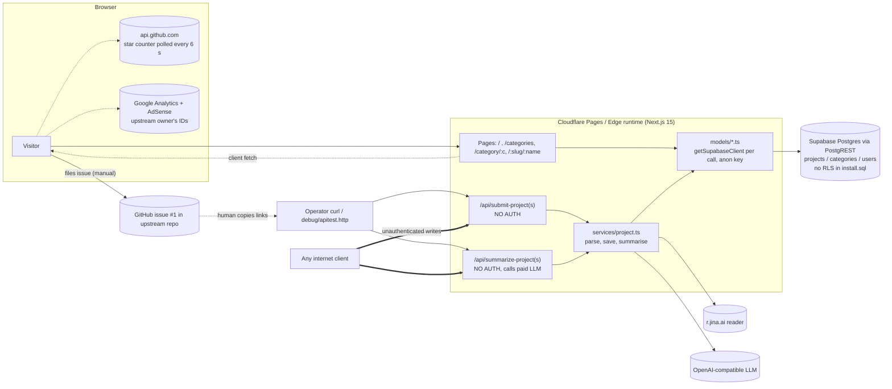

# Architecture Audit

Scope: the fork of `chatmcp/mcpso` at commit `ddcdb9d` (2025-03-27, last upstream commit; 20 commits total, ~2,700 lines of TypeScript across 60 tracked source files).
Method: every file was read; behaviour was exercised by running the app (Next.js dev server) against a **fixture** PostgREST server (`tools/audit/fake-postgrest.mjs`), never against a real database. Raw evidence is in `reports/evidence/`.

Confidence tags: **[C]** confirmed by execution or direct source reading, **[S]** suspected / needs a real environment to confirm.

## 1. What the application actually is

A read-mostly Next.js 15 (App Router) site, deployed (per `package.json` scripts) to **Cloudflare Pages** via `@cloudflare/next-on-pages`, backed by a single **Supabase (PostgREST)** project queried with the **anon key** from server code. There is no user authentication, no admin UI, no background job system, no CI, no tests and no deployment config in the repository.

| Concern | What exists | Evidence |
|---|---|---|
| Framework / runtime | Next 15.0.4, React 19.0.0, TypeScript 5.7 (strict), Tailwind 3.4, `runtime = "edge"` on all 8 pages/routes | `package.json`, `reports/evidence/unused-deps.txt` |
| Package manager | pnpm (`pnpm-lock.yaml`) **and** a stale `package-lock.json` (pins `next@15.0.3`; `npm ci` fails with ERESOLVE) | `reports/evidence/npm-ci-dry-run.txt` |
| Data store | 3 tables (`users`, `projects`, `categories`), no FKs, no RLS statements | `data/install.sql` |
| Auth | **None.** `users` table and `models/user.ts` are dead code (no sign-in flow) | `models/user.ts`, grep for callers |
| Submission | Out-of-band: visitors file a GitHub issue (`Submit` nav link → upstream issue #1); an operator then POSTs to `/api/submit-project(s)` by hand (`debug/apitest.http`) | `pagejson/en.json:17-21`, `debug/apitest.http` |
| Enrichment | `POST /api/summarize-project(s)` fetch README through the third-party `r.jina.ai` reader and summarise with an OpenAI-compatible LLM | `services/project.ts:85-170`, `services/reader/jina.ts` |
| Search | `ILIKE %kw%` over name/title/description via PostgREST `or=` filter; no index, no ranking, first 100 rows | `models/project.ts:154-175` |
| Sitemaps | Static XML files in `public/` listing 308 project URLs on `https://mcp.so`; the generator route `app/api/update-sitemaps` is **git-ignored and absent** | `public/sitemap_projects_1.xml`, `.gitignore`, `debug/apitest.http:46` |
| Observability | `console.log` of whole request/response objects (15 occurrences in server code); no metrics, no error tracking | `reports/evidence/unused-deps.txt` |
| Analytics / ads | Google Analytics `G-9ZWF7FKDR8` and AdSense `ca-pub-2123767634383915` **belonging to the upstream owner** are embedded | `providers/theme.tsx:10-34`, `app/layout.tsx:27`, `public/ads.txt` |

## 2. Architecture diagram (as built)

Data flow notes:
* Public reads: Page → `models/project.ts` → one PostgREST call per query. A single `/server/:name` view makes the same `projects?name=eq.X` query **twice** (`generateMetadata` and the page body), plus a category lookup and a 50-row "more projects" query (see `reports/evidence/ui/postgrest-requests.log`).
* Writes: `submit-project` → `parseProject` → `saveProject` → `insertProject`/`updateProject` using the **anon** key. For this to work at all, the production database must either have RLS disabled or an `anon` write policy; either way the browser-visible anon key is a write credential (see `security-audit.md` F-01/F-02).
* Enrichment: `sumProject` fetches `https://raw.githubusercontent.com/<owner>/<repo>/main/README.md` through Jina, sends the README text and the whole project JSON to the LLM, and writes the LLM's category/tags/summary back to the row. Untrusted README text therefore flows into a prompt and then into published content with no review step.

## 3. Findings

| ID | Finding | Sev. | Conf. | Files |
|---|---|---|---|---|
| A-01 | **Write endpoints are unauthenticated** and share the anon DB key; authorization depends entirely on database configuration that is not in the repo | Critical | C | `app/api/*/route.ts`, `models/db.ts` |
| A-02 | **Production build fails** with a TypeScript error (`KeyboardEvent` is not generic) → the project cannot be deployed from a clean checkout | High | C | `templates/tailspark/landing/components/search/index.tsx:25`, `reports/evidence/build.txt` |
| A-03 | No `.github/`, no CI, no tests, no lint configuration; `next lint` blocks on an interactive prompt | High | C | `reports/evidence/next-lint.txt`, `ci-config.txt`, `test-script.txt` |
| A-04 | Domain model is a single flat `projects` table: **no repository identity, no provenance, no verification state, no submission history**; `name` is the only uniqueness key, so identity is "whatever slug the submitter chose" and re-submission overwrites | High | C | `data/install.sql:16-37`, `services/project.ts:172-206` |
| A-05 | The submission workflow lives outside the product (GitHub issue #1, 1,450+ comments) and is bridged by hand; there is no status, no deduplication and no feedback to the submitter | High | C | `pagejson/en.json`, `debug/apitest.http` |
| A-06 | Business logic (parsing, persistence, LLM summarisation, third-party fetching) is mixed in `services/project.ts`; routes are thin but untestable because every function builds its own Supabase/OpenAI client from `process.env` | Medium | C | `services/project.ts`, `models/db.ts`, `services/llms/openai.ts` |
| A-07 | Fork still emits the **upstream operator's** GA and AdSense identifiers and `mcp.so` branding in policy pages, footer, sitemaps, canonical URLs, FAQ copy and e-mail address → analytics data and ad revenue attribution go to a third party; the privacy policy describes services (accounts, hosting) that do not exist | High | C | `providers/theme.tsx`, `app/layout.tsx`, `public/ads.txt`, `pagejson/en.json:175-178`, `app/(policy)/privacy-policy/page.tsx` |
| A-08 | Client polls the unauthenticated GitHub API **every 6 s per visitor** for a star count; the 60 req/h per-IP limit is exhausted in ~6 minutes, after which the counter silently shows 0 | Medium | C (code) | `templates/.../hero/github.tsx:19-33`, `hero/buttons.tsx:11` |
| A-09 | Dead or unreachable code: `models/user.ts`, `extractProject`, `genUniSeq`, `parseEventData`, `isSmScreen`, `removeYamlMarkers`, mobile `DropDown`, `pagejson` keys, `form action="/gpts/search"` (route does not exist), `debug/` → `/api/update-sitemaps` (route absent) | Low | C | various |
| A-10 | `[slug]` route segment is ignored: `/anything/fixture-1` renders the same page as `/server/fixture-1`, and missing projects/categories return **HTTP 200** with a bare `
` (soft 404) | Medium | C | `app/(default)/[slug]/[name]/page.tsx`, `reports/evidence/ui/fetch-summary.txt` |
| A-11 | Edge runtime is declared everywhere although nothing needs it; combined with a deprecated adapter this couples the app to one platform | Medium | C | `reports/evidence/pnpm-outdated.txt` (`@cloudflare/next-on-pages` flagged deprecated) |
| A-12 | Search is a sequential scan: `ILIKE '%kw%'` on 3 columns with no `pg_trgm`/FTS index; fine at 300 rows, not at the 3,000-5,000 projects this audit's dataset implies | Medium | S (needs real DB `EXPLAIN`) | `models/project.ts:154-175`, `data/install.sql:47-49` |

### Tightly coupled / duplicated / hard-to-test components

* `models/*` are thin PostgREST wrappers that **swallow errors into empty results** (`if (error) return []`) so a database outage renders as "0 servers" with HTTP 200 (`models/project.ts:63,111,131,172`).
* `getProjectsCountByCategory` is called once per category inside `getCategories` (`models/category.ts:44-47`): 1 + N queries per `/categories` request (6 extra queries with 6 fixture categories; confirmed in the request log). The unawaited `Promise` is stored in `projects_count`; React 19 resolves it during rendering so the page shows correct numbers (verified in `reports/evidence/ui/categories.png`), but the data shape is wrong and untestable.
* `getProjectsCount` uses `select("count")`, which is a PostgREST aggregate that only works if aggregates are enabled on the project **[S]**; on failure it returns 0 and the hero shows "0 MCP Servers Stored".
* `templates/tailspark/landing/*` is a vendored UI template with marketing structure (hero/FAQ/stars) tightly bound to `pagejson/en.json`; presentational and data concerns are not separated.
* `utils/time.ts` and `utils/index.ts` both define `getIsoTimestr` (duplicate).

## 4. Components likely to create operational problems

1. **`/api/summarize-projects`**: each call can trigger up to `limit` (client-chosen, unbounded) LLM calls and Jina fetches in parallel via `Promise.all`; with `limit=100000` the app issued `...&offset=0&limit=100000` to the database (`reports/evidence/api-probe/results.txt`). Cost and availability risk.
2. **`/api/submit-projects`**: no cap on array length; 200 items produced 202 database requests in one invocation (`reports/evidence/api-probe/`).
3. **Per-request client construction** (`createClient` on every call) is cheap on edge but prevents connection reuse, retries, and central instrumentation.
4. **Static sitemaps** will go stale immediately; there is no regeneration path in the repository.

## 5. Recommended changes (architecture level)

Ordering reflects dependency, not just severity; full sequencing is in `prioritized-roadmap.md`.

1. **Close the write path first** (A-01): remove public write endpoints; put all writes behind authenticated server actions or a separate ingestion service using a *service* credential that never reaches the edge runtime; enable RLS with read-only `anon` policies.
2. **Make the build green and reproducible** (A-02, A-03): fix the type error, pick one lockfile (pnpm), pin Node in `.nvmrc`/`engines`, add CI (typecheck, lint, test, build, audit).
3. **Introduce a real domain model** (A-04, A-05): `servers`, `repositories` (canonical identity), `source_submissions`, `submission_events`, `verification_jobs/results`, `security_findings`; see `target-architecture.md`. The importer in `tools/upstream-import/` already produces data in this shape.
4. **Split ingestion from presentation**: the importer/verifier is a separate worker project, not routes in the Next app.
5. **Remove inherited identifiers and branding** (A-07) before any public deployment; this overlaps with the rebranding work.
6. **Replace the vendored template** with a small component set and server-rendered, indexable pages with proper 404 semantics (A-10); see `ui-ux-audit.md`.
7. **Decide on hosting deliberately.** Nothing in the code requires the edge runtime; the simplest operable target is a standard Node deployment (or Cloudflare via the maintained OpenNext adapter if edge hosting is wanted).
