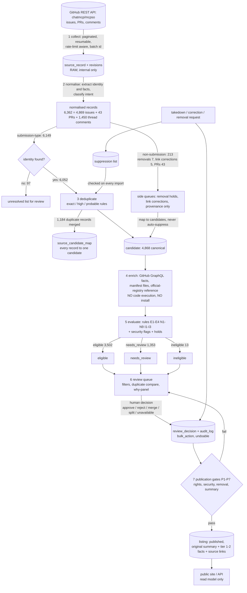

# Import Data Flow

Counts shown are the **measured** results of the audit run on 2026-10-16 (`data/upstream-import/reconciliation.md`); a new run will differ because upstream keeps growing. The earlier historical estimate of about 2,900 requests is not reproduced: the measured figures are 4,869 issues, 43 pull requests and 4,868 canonical candidates (see §3).

## 1. Diagram



ASCII equivalent (stages and gates):

```
GitHub API --1 collect--> source_record (raw, internal)
   --2 normalise--> records --3 dedup--> candidates + source_candidate_map
   --4 enrich (read-only API, no code run)--> --5 evaluate--> eligible | needs_review | ineligible
   --6 review queue (human)--> review_decision/audit --7 gates P1..P7--> listing (published)
 takedown/removal --> suppression --checked by--> every future import
```

## 2. Stage contract

| # | Stage | Input → output | Automated? | Idempotency / safety |
|---|---|---|---|---|
| 1 | Collect | API pages → `source_record`, `import_batch`, `import_checkpoint`, `import_error` | yes | keyed by (repo, kind, GitHub id); upsert; changed content hash stores a revision; bounded concurrency; backoff with jitter; `--incremental` by watermark; dry-run writes nothing |
| 2 | Normalise | raw → records with claims, intent, security flags | yes | pure function of raw; reruns overwrite derived rows only |
| 3 | Deduplicate | records → candidates + mapping + duplicate groups | rules yes; uncertain matches proposed | reversible merges (`merge_history`); never merges on name similarity alone |
| 4 | Enrich | candidates → repository facts, manifest evidence, registry reference | yes | API-only, cached, resumable, one query per project key; no clone, no install, no execution |
| 5 | Evaluate | facts → category, rule IDs, evidence, quality and security flags | yes | versioned evaluator; `is_current` evaluation per candidate |
| 6 | Review | queue → decisions | **human** | audit log; bulk actions previewed and undoable |
| 7 | Publish | approved → `listing` | **human approval + gates** | rights tiers; original summaries; suppression list consulted |

## 3. Reconciliation (measured, audit run)

| Stage | Figure |
|---|---|
| Retrieved | 4,869 issues (4,403 open / 466 closed); 43 PRs (separate from issues; the issues endpoint also returned them and they were split out); 2,412 comments of which 1,450 are on the submission thread; 0 API errors; 595 numbers in 1..5,507 unretrievable |
| Normalised records | 6,362 (= 4,869 + 43 + 1,450) |
| Submission-type records ("relevant addition requests") | 6,149 (6,052 with a usable identity, 97 without) |
| Not submissions | 213 (110 no identity, 48 questions/feedback, 43 code contributions, 7 removal requests, 5 link corrections) |
| Duplicate records merged | 1,184 (6,052 − 1,184 = 4,868) |
| Canonical candidates | 4,868 |
| Evaluation | eligible 3,502; needs_review 1,353; ineligible 13 |
| Import-ready (eligible, no security flag, no removal hold) | 3,467 |
| Approved / published | 0 / 0 (review not started) |

The difference between "about 2,900 requests" and these figures cannot be explained from the data: the origin of the 2,900 estimate is unknown, the upstream repository grew by hundreds of issues per month through 2026 (925 issues in the first 16 days of October), and one identity (record → candidate) can carry several records. The importer therefore reports its own counts and does not target the estimate.
