# Prioritised Implementation Roadmap

> **Scope update (master plan rev 4):** the product is an independently operated registry built by enhancing this codebase; importing and evaluating the upstream addition requests (R07) is a core workstream, but with its own brand, infrastructure and data model and without upstream branding or runtime dependence. Statements here that treat the product as a rebrand of mcp.so are superseded; see `master-plan.md` and `master-plan-changelog.md`.

Effort units (relative, for one engineer familiar with the stack; deliberately coarse, not hour estimates): **S** ≈ up to 2 days · **M** ≈ 3-8 days · **L** ≈ 2-4 weeks · **XL** > 1 month. Risk = risk of the *change* breaking things or stalling. IDs reference findings in the other reports (A=architecture, Q=code quality, F=security, D=dependency, U=UI/UX, T=threat model).

Priority legend: **P0** critical (security, data exposure, broken core, release blockers) · **P1** high · **P2** medium · **P3** low.

## 0. Sequencing at a glance

```mermaid
gantt
  dateFormat  X
  axisFormat  %s
  title Suggested sequence (relative; units = work-weeks, one engineer)
  section P0 stabilise
  R01 R02 R03 R04 R05 quick wins :a1, 0, 2
  section P1 foundation
  R06 data model + RLS            :b1, 1, 3
  R07 import + review queue       :b2, after b1, 2
  R12 headers, limits, logging    :b3, 1, 2
  R14 tests + CI gates            :b4, 1, 3
  R09 read pages rebuild          :b5, after b1, 3
  R08 submission + status         :b6, after b2, 3
  R10 reviewer UI                 :b7, after b2, 2
  R11 static inspector + evidence :b8, after b2, 2
  R13 search                      :b9, after b5, 1
  R15 rebranding execution        :b10, 0, 3
  section Launch gate
  Public launch (P0 + P1 + R15)   :milestone, 9, 0
  section P2/P3 after validation
  R16 R17 R18 R19                 :c1, 9, 4
  R20 R21 R22 sandbox/probe/search:c2, 13, 8
```

**Launch gate:** all P0, plus R06-R15 (P1 items and the rebrand). **After initial validation:** R16-R19 (P2) and R20-R22 (P3).
**Quick wins** (≤ 2 days each, no design needed): R01, R02, R03, R04, plus the fixes in the "Quick-win checklist" at the end.
**Structural changes:** R06, R08, R09, R11, R20.

## P0: critical

### R01: Remove the public write and LLM-trigger endpoints (S)
* **Problem:** anyone can create/overwrite/soft-delete listings and trigger paid LLM calls.
* **Evidence:** F-01, F-02, F-04; executed against fixture: `reports/evidence/api-probe/results.txt`.
* **Impact:** catalogue defacement or hijack, unbounded spend; makes any later "trust" claim worthless.
* **Solution:** delete or disable `/api/submit-project(s)`, `/api/summarize-project(s)` in the deployed app (return 404/410); keep an operator CLI/script that uses a server-only credential for any needed bulk changes until R06-R08 land.
* **Dependencies:** none. **Risk:** low (the site is read-only for visitors today).
* **Acceptance:** anonymous POST to each former route returns 404/410; no route can write without authentication; LLM key removed from the public environment.
* **Tests:** integration test asserting 4xx for anonymous writes; deployment smoke check.

### R02: Dependency emergency fixes (S)
* **Problem:** `next@15.0.4` (37 advisories, 4 critical), vulnerable transitive tree, two disagreeing lockfiles, deprecated adapter.
* **Evidence:** D-01..D-04; `pnpm-audit.txt`, `npm-ci-dry-run.txt`.
* **Solution:** `next@^15.5.28`, matching `react`/`react-dom` patch, `markdown-it@^14.3.1`, `postcss`, `supabase-js` latest 2.x; remove `vercel`, `xmlbuilder`, `next-themes`, `@types/uuid`; delete `package-lock.json`; add `packageManager` and `engines`.
* **Dependencies:** R03 (build must pass first to verify). **Risk:** low-medium (Next 15.0→15.5 minor jumps).
* **Acceptance:** `pnpm audit --prod` shows 0 critical/high; clean install with `--frozen-lockfile`; app renders all routes.
* **Tests:** build + smoke tests of `/`, `/categories`, `/category/x`, detail page.

### R03: Make the build green and add a CI skeleton (S)
* **Problem:** production build fails (type error); no CI, tests, or lint config; search input stays disabled after the first search.
* **Evidence:** Q-01, Q-02, A-02, A-03; `build.txt`.
* **Solution:** import `KeyboardEvent` from `react` (one line) and re-enable the input from `useSearchParams`/`useTransition` pending state instead of a stale prop; add ESLint (`eslint-config-next`) and Prettier; GitHub Actions: install (frozen, `--ignore-scripts`), typecheck, lint, build, `pnpm audit --prod`, secret scan; least-privilege `permissions: contents: read`, actions pinned to SHAs.
* **Dependencies:** none. **Risk:** low.
* **Acceptance:** CI green on a clean clone; failing audit or type error blocks merge.
* **Tests:** a component test for search re-enable behaviour.

### R04: Remove inherited identifiers, fake trust signals and upstream branding (S)
* **Problem:** upstream owner's GA/AdSense IDs, `mcp.so` branding/e-mail/policies, hard-coded 5-star ratings, GitHub star polling.
* **Evidence:** A-07, U-01, U-19, F-09, F-12, A-08.
* **Solution:** delete GA/AdSense scripts and `ads.txt`; remove `Stars`; neutral placeholder branding until R15; rewrite policies to match actual processing; fetch the star count server-side or remove it.
* **Dependencies:** none (final identity follows R15). **Risk:** low.
* **Acceptance:** no third-party identifier from the upstream remains (`grep` check in CI); no rating UI without data.
* **Tests:** CI grep for `G-9ZWF7FKDR8`, `ca-pub-`, `mcp.so`.

### R05: Verify and enforce database security (S, requires access to the live project)
* **Problem:** schema ships no RLS; app uses the anon key for writes; `users` table with e-mail/IP.
* **Evidence:** F-03, `data/install.sql`.
* **Solution:** audit live policies; enable RLS everywhere; `anon` = `SELECT` on published listings only; drop `users`; if the anon key had write access, rotate keys and review the audit log for tampering.
* **Dependencies:** access to the Supabase project. **Risk:** medium (could break the current app if it relies on anon writes; coordinate with R01).
* **Acceptance:** `relrowsecurity = true` for all public tables; anon cannot `INSERT/UPDATE/DELETE`; documented policy tests pass.
* **Tests:** automated RLS tests (anon vs service) in CI against a local Postgres.

## P1: high

### R06: Registry data model, migrations, RLS (L, structural)
* **Problem:** one flat table, no identity/provenance/verification/history.
* **Evidence:** A-04, A-05; target schema in `target-architecture.md` §2.
* **Solution:** migrations (versioned SQL) for `server`, `repository`, `server_repository`, `source_submission`, `submission_event`, `package_ref`, `remote_endpoint`, `verification_job/result`, `security_finding`, taxonomy; RLS; seed/fixture data; generated TS types.
* **Dependencies:** R05. **Risk:** medium (design mistakes are costly later; review the schema against the importer outputs first).
* **Acceptance:** a fresh database can be built from migrations; importer output loads without information loss; RLS tests pass.
* **Tests:** migration up/down tests; constraint tests (canonical-key uniqueness, subpath rules).

### R07: Import the upstream dataset into a review queue (M)
* **Problem:** thousands of unreviewed submissions exist upstream; nothing is imported or de-duplicated.
* **Evidence:** `submission-dataset-analysis.md` (counts), importer in `tools/upstream-import/`.
* **Blocker:** removal requests whose target could not be mapped to a project (see `classified/removal-candidates.csv`, `removal-like-comments.csv` and the *unmapped* count in `classification-summary.json`) **block publication of the affected entries** until a human confirms or dismisses each one; suppression is never inferred automatically.
* **Solution:** load `classified/*` into `source_submission/server/repository`; apply `removal-requests.jsonl` as suppressions *before* publication; publish only `import_ready` entries at evidence level L2, queue `needs_review`, keep `ineligible` unpublished with reasons; schedule incremental sync; preserve attribution/provenance links.
* **Dependencies:** R06. **Risk:** medium (data quality; legal/attribution).
* **Acceptance:** counts reconcile with `classification-summary.json`; no suppressed item is published; every published listing links to its source issue(s).
* **Tests:** idempotent reload test; reconciliation script; sample-based precision check (manual, ≥ 100 items).

### R08: Authenticated submission, duplicate detection, status page (L)
* **Problem:** submissions happen in a GitHub issue thread with no feedback; duplicates are common.
* **Evidence:** U-04, A-05; duplication rates in the dataset analysis.
* **Solution:** GitHub sign-in; submission form (repo URL / package / endpoint); canonicalisation + duplicate check before submit; ownership proof; rate limits/quotas; status page with lifecycle events (`target-architecture.md` §3).
* **Dependencies:** R06, R12. **Risk:** medium (abuse handling).
* **Acceptance:** an owner can submit and see each state with timestamps and reasons; duplicates are detected on the canonical key; no state persists beyond its timeout.
* **Tests:** unit tests for canonicalisation (reuse `urls.test.mjs` cases), state-machine tests, e2e of the submit→status flow.

### R09: Rebuild the public read experience (L, structural)
* **Problem:** no pagination/filters/install info; soft 404s; 481 kB detail bundle; no mobile nav.
* **Evidence:** U-02, U-03, U-05..U-08, U-17, Q-08, A-10.
* **Solution:** server-rendered list with pagination, filters and sorting; detail page with install blocks, evidence panel, provenance; `notFound()`; single `/servers/{slug}` route; server-side Markdown; responsive nav.
* **Dependencies:** R06 (data), R07 (content). **Risk:** medium.
* **Acceptance:** detail first-load JS ≤ 120 kB; 404 for unknown routes; all filters work; axe has no serious violations.
* **Tests:** component + e2e tests (Playwright), a11y checks, bundle-size budget in CI.

### R10: Reviewer UI with audit log (M)
* **Problem:** no admin tooling; changes are unattributable.
* **Evidence:** A-01, T1, T11.
* **Solution:** role-gated queue (risk/age sort, evidence, duplicates, flags), accept/reject/suppress/merge with reason, append-only `submission_event` log.
* **Dependencies:** R06, R07. **Risk:** low-medium.
* **Acceptance:** every state change records actor, time, reason; reviewers can resolve the `ambiguous-for-manual-review` and `security-concerns` lists.
* **Tests:** authorisation tests; audit-log completeness tests.

### R11: Static inspection pipeline and evidence panel (M)
* **Problem:** no verification; evidence levels not represented.
* **Evidence:** U-06, §3.4 of target-architecture; eligibility rules.
* **Solution:** worker applying S0/S1 (manifests, `server.json`, SPDX, lockfile → OSV advisories, activity), official-registry sync, evidence/expiry model, UI panel with the six-level vocabulary.
* **Dependencies:** R06. **Risk:** medium (false positives/negatives in SDK detection; maintain the signature list).
* **Acceptance:** each listing shows dated L1/L2/L6 results; unperformed levels read "not performed"; results expire and re-queue.
* **Tests:** fixtures of manifests per language; golden tests of `classify` rules.

### R12: Platform hardening (M)
* **Problem:** no rate limits, headers/CSP, structured logs; HTTP-200 errors.
* **Evidence:** F-06, F-09, F-10, F-11, Q-05, Q-07.
* **Solution:** edge rate limits + body-size caps; security headers and a strict CSP; structured redacting logger; correct status codes; error tracking; origin checks on mutating routes.
* **Dependencies:** R03. **Risk:** low-medium (CSP breakage).
* **Acceptance:** `securityheaders`-style checks pass in CI; load test shows limiter engaging; no secret in logs (test with canary values).
* **Tests:** integration tests for 429/413/4xx; log-redaction unit tests.

### R13: Search (M)
* **Problem:** `ILIKE` scans, filter injection, no ranking.
* **Evidence:** A-12, F-08, Q-13.
* **Solution:** Postgres FTS + `pg_trgm`, parameterised search function, pagination; 100-query evaluation set tracked in CI.
* **Dependencies:** R06, R07. **Risk:** low.
* **Acceptance:** injection probe returns normal results; p95 query time recorded on the real catalogue size; evaluation nDCG@10 baseline stored.
* **Tests:** search unit/integration tests with adversarial inputs.

### R14: Test strategy and coverage (M)
* **Problem:** zero tests; project standard requires ≥ 80%.
* **Evidence:** A-03, Q section 5.
* **Solution:** unit tests for canonicalisation, extraction, classification (port the importer tests), integration tests against a Postgres service container, Playwright e2e for critical flows (search, submit, status), axe smoke tests.
* **Dependencies:** R03. **Risk:** low.
* **Acceptance:** coverage ≥ 80% on `src/` domain code; CI blocks regressions.

### R15: Execute the rebrand (M, parallelisable from day 1)
* **Problem:** the fork carries another product's identity.
* **Evidence:** `rebranding-proposal.md` (finalists; no trademark search performed).
* **Solution:** pick a name after counsel-led trademark search; secure domains/handles; original visual identity; replace names in code, packages, docs, policies.
* **Dependencies:** legal search. **Risk:** medium (name conflicts).
* **Acceptance:** no residual `mcp.so`/upstream branding; domain and org/repo names registered; licence notices retained (Apache-2.0).

## P2: medium

* **R16 SEO foundation (M):** sitemap from DB, JSON-LD, OG tags, indexation rules for thin pages (`performance-seo-growth.md`). *Depends on R09. Acceptance:* sitemap contains only index-eligible listings; Search Console shows no soft-404.
* **R17 Operations (M):** managed backups with a tested restore drill, uptime checks, dashboards (queue age, job latency), alerting, runbooks, staging environment. *Depends on R06.* *Acceptance:* a restore drill completed and documented.
* **R18 Importer hardening (S-M):** scheduled incremental sync, size caps (done: 100k chars) and ReDoS/fuzz tests for `extract.mjs`, GitHub token-pool budget, alert on schema drift of issue templates, handle issue-form templates. *Acceptance:* weekly sync runs unattended; fuzz suite passes.
* **R19 Read-only API, export, badges (M):** documented JSON API and bulk export with attribution/licence metadata; "Listed on" badge for owners. *Depends on R06/R09.*
* **R20-lite Corrections flow (S-M):** "report a problem" and owner-verified removal path (needed earlier for legal/trust reasons if the dataset goes live; treat as part of R08 if time allows).

## P3: low / future

* **R20 Sandbox runner for opt-in build/protocol tests (XL):** only after a security review of the isolation design (`security-audit.md` §4); separate cloud account, microVM per job, no secrets, no egress. *Risk: high.*
* **R21 Remote endpoint prober with ownership proof (L):** SSRF-hardened, rate-limited, after DNS/`.well-known` ownership verification.
* **R22 Advanced discovery (L):** semantic search, capability facets, related-server graph, only if usage data shows need.
* **Explicitly out of scope until validation:** payments, subscriptions, sponsored placement, hosted execution of third-party servers.

## Quick-win checklist (all ≤ 1 day, independent)

1. Add `import type { KeyboardEvent } from "react"` (Q-01).
2. `alt=""` on decorative images; allow zoom in the viewport meta (U-09, U-10).
3. `notFound()` instead of the bare `
` for missing servers/categories (U-07).
4. Remove the dead `form action="/gpts/search"` and the unused utilities (A-09).
5. Delete `package-lock.json`; add `engines`/`packageManager` (D-04).
6. `robots.txt`: add `Sitemap:`, fix the trailing-slash rule (U-16).
7. Fix `getRandomProjects` to sample properly or remove "View More" until related-servers exist (Q-09).
8. Replace `console.log(...)` of objects with a redacting logger (Q-14).

## Dependencies between items

`R05 → R06 → {R07, R09, R11, R13}`; `R03 → {R02, R12, R14}`; `R07 + R12 → R08`; `R07 → R10`; `R09 + R11 → R16`; `R15` is independent but gates launch. Nothing in P3 should start before R12 and R11 are complete.
