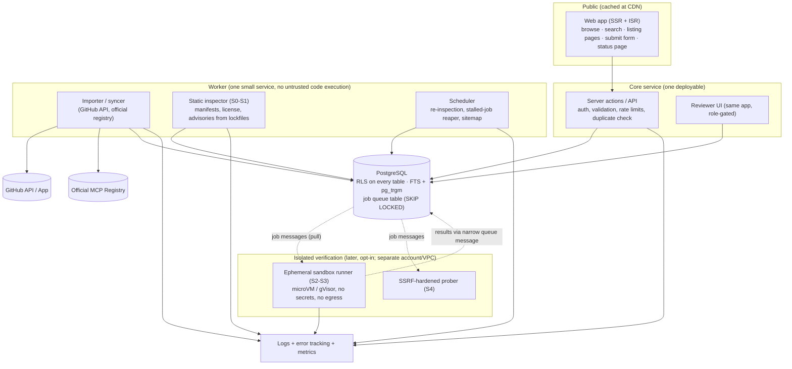
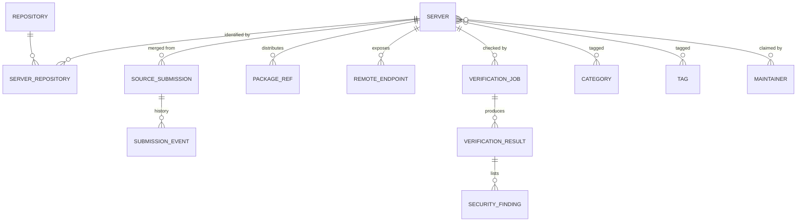
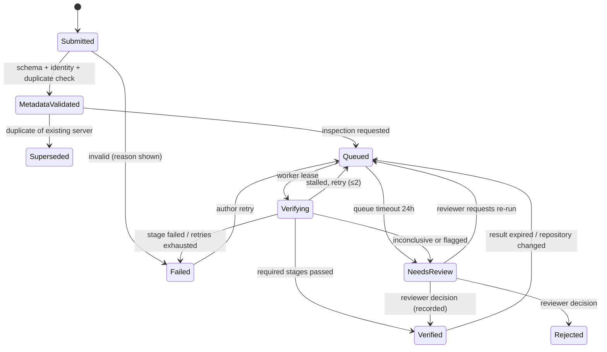

# Target Architecture

> **Scope update:** the product direction changed to a new, independent application with no relation to mcp.so and no use of upstream data or code (see `master-plan.md` rev 2). Items in this report that assume continuing the fork, importing the upstream dataset (R07) or rebranding mcp.so are superseded; the audit findings and lessons remain valid.

Design principle: **the simplest system that meets demonstrated needs.** Each component below names the audit finding or dataset fact that justifies it; components with no demonstrated need are explicitly deferred. Scale reference points *measured* in this audit (details and denominators in `submission-dataset-analysis.md`): 4,869 issues, 43 PRs and 2,412 comments collected from the upstream repository; ~6,000 submission records collapsing to roughly 4,900 candidate projects on ~3,970 distinct GitHub repositories; issue volume rising from 441 (Aug 2026) to 647 (Sep 2026) to 925 in the first 16 days of Oct 2026; the official MCP Registry snapshot (read-only) lists tens of thousands of entries (exact count in `classification-summary.json`). Those are small numbers for a relational database; the growth rate, not the size, is the planning constraint.

## 1. Architecture overview

## 2. Registry data model (non-destructive, provenance-first)

| Entity | Key fields | Notes |
|---|---|---|
| `server` | `id` (stable; derived from canonical key), `slug`, `name`, `description`, `status` (`draft/published/suppressed/removed`), `evidence_summary` (denormalised highest level + dates), `first_published_at`, `updated_at` | the listing; never hard-deleted (`suppressed`/`removed` + reason) |
| `repository` | `canonical_key` (e.g. `github.com/o/r`), `host`, `owner`, `name`, `default_branch`, `archived`, `fork`, `license_spdx`, `pushed_at`, `renamed_from[]`, `last_fetched_at` | one row per repository; rename/transfer history kept |
| `server_repository` | `server_id`, `repository_id`, `subpath` | monorepo servers: many servers per repository (e.g. a single repository was submitted as 94 distinct hosted servers in the upstream data) |
| `source_submission` | `source` (`github_issue`, `github_comment`, `web_form`, `official_registry`), `source_ref`, `author_login`, `received_at`, `raw` (jsonb, immutable), `normalized` (jsonb), `server_id` (nullable until merged), `merge_rule`, `merge_reason` | every importer record maps 1:1; multiple submissions → one server |
| `submission_event` | `submission_id`, `at`, `actor` (system/user/reviewer), `type`, `from_state`, `to_state`, `reason_code`, `detail` | append-only audit trail |
| `package_ref` | `server_id`, `registry` (npm/pypi/oci/nuget/…), `identifier`, `version_hint` | from manifests, not submitter prose |
| `remote_endpoint` | `server_id`, `url`, `transport`, `ownership_verified_at`, `restricted` | never fetched by the control plane |
| `verification_job` | `id`, `server_id`, `stage` (`S0`…`S4`), `commit_sha`, `requested_by`, `state`, `attempt`, `heartbeat_at`, `started_at`, `finished_at`, `timeout_at`, `idempotency_key`, `sandbox_image_digest`, `limits` | one job per stage per commit |
| `verification_result` | `job_id`, `level` (see §3.4), `outcome` (`passed/failed/not_applicable/inconclusive`), `evidence` (jsonb), `performed_at`, `expires_at` | levels never merged into one boolean |
| `security_finding` | `result_id`, `kind` (advisory, install-script, secret, injection-text, impersonation…), `severity`, `detail`, `source`, `status` | feeds the evidence panel |
| `category`, `tag` | taxonomy; free tags are normalised | |
| `maintainer` | verified GitHub identity, `claimed_server_ids` | ownership proof |

The importer's output (`dedup/projects.jsonl`, `classified/*`) is already shaped to load into `source_submission` + `server` + `repository` + `security_finding` with no information loss.

## 3. Submission workflow

### 3.1 States

`Submitted → Metadata Validated → Queued → Verifying → Verified | Failed | Needs Review` (+ terminal `Rejected`, `Withdrawn`, `Superseded`).

| State | Precise meaning | Entered when | Exit / timeout |
|---|---|---|---|
| **Submitted** | Received and stored immutably; nothing checked yet | form post or import | synchronous validation; if it does not complete in **60 s** → `Failed(reason=validation_timeout)` and the user sees an error immediately |
| **Metadata Validated** | Schema-valid, canonical identity resolved, duplicate check done, ownership state known (owner / third party) | validation passes | immediately enqueues static inspection; duplicates become `Superseded` (linked to the existing server) with the reason shown |
| **Queued** | Waiting for a worker for the stage(s) required | job created | alert if waiting **> 1 h**; after **24 h** → `Needs Review(reason=queue_timeout)` |
| **Verifying** | A job holds a lease and sends heartbeats | worker claims a job | **heartbeat every 15 s**; no heartbeat for **90 s** = stalled → job is cancelled and requeued (max **2** retries, exponential backoff) → then `Failed(reason=stalled)`; hard stage timeouts: S1 5 min, S2 10 min, S3 2 min, S4 1 min |
| **Verified** | The *requested* stages ran and met their pass criteria; **always displayed with the levels achieved and dates**, never as a bare "verified" | all required results `passed` | results **expire** (default 90 days; remote endpoints 30 days) → re-queued |
| **Failed** | A stage ran and failed, or infrastructure failed after retries | job outcome | author sees plain-language reason + "retry" (rate-limited) and the full history |
| **Needs Review** | Automated evidence is inconclusive or a rule requires a human (ambiguity, security flag, fork, unresolved repo) | rule hit | reviewer decision within a published target (e.g. 7 days); SLA breaches are surfaced; items never sit unreported |

Principles: publication is **decoupled** from verification. A listing can be published at "Repository inspected" while deeper stages are pending, not offered, or failed. The submitter always receives a response immediately (receipt + status URL); no request waits on a build.

### 3.2 Publication vs verification

### 3.3 Eligibility → publication policy (derived from the dataset audit)

Eligible + not security-flagged → auto-publish at level "Repository inspected". Needs review → reviewer queue (sorted by risk/age; bulk actions for the most common reasons). Ineligible → rejected with a reason code (author may appeal). Security-flagged → never auto-publish.

### 3.4 Evidence levels (must never be conflated)

`L1 Metadata validated` · `L2 Repository inspected` (static) · `L3 Build passed` (sandbox) · `L4 MCP protocol test passed` (sandbox or probe) · `L5 Remote endpoint reachable` (prober, ownership verified) · `L6 Security checks performed` (a *list of named checks* with findings; not a pass/fail).
A passed `L3` says nothing about `L4`; `L4` says nothing about behaviour or safety; `L5` says nothing about protocol correctness. Each result stores what was run, the commit/endpoint, tool versions and when.

## 4. Verification architecture: approaches compared

| Check | Approach | Safe to automate? | Needs human/credentials? | Notes |
|---|---|---|---|---|
| Metadata validation | schema + canonicalisation | Yes | no | in the request path |
| License detection | GitHub API SPDX + `LICENSE` parse | Yes | no | |
| Dependency vulnerabilities | parse lockfile **text** → OSV query | Yes | no | no install; coverage depends on lockfile presence |
| Repository activity | GitHub API (`pushed_at`, archived, releases) | Yes | no | |
| MCP manifest validation | `server.json` schema; official-registry match | Yes | no | strong evidence for L2 |
| Static SDK-dependency detection | manifest scan (implemented) | Yes | no | allow-list must be maintained |
| Build | sandboxed `ci`-style install + build, scripts off by default | Opt-in only | no | arbitrary code risk; sandbox mandatory (security-audit §4) |
| Protocol test, local `stdio` | spawn in sandbox, `initialize` + `tools/list`, time-boxed | Opt-in only | often needs env/API keys → status `requires_credentials` | do not report pass without it |
| Protocol test, remote HTTP/SSE | prober to public HTTPS endpoint | Opt-in, after ownership proof | auth-dependent servers need owner-provided test credentials | unauthenticated 401 on `initialize` is "reachable, auth required", not "passed" |
| Authentication-dependent servers | owner attestation + reviewer | No | yes | |
| Servers needing external paid services | owner attestation | No | yes | |
| Malicious-behaviour assessment | reviewer using flags | No | yes | automation only prioritises |

There is **no single universal test**; each listing shows exactly the levels that apply. "Not applicable" and "not performed" are valid, visible outcomes.

## 5. Operations

| Concern | Recommendation | Justification |
|---|---|---|
| **Job queue** | Postgres table + `SELECT … FOR UPDATE SKIP LOCKED` (or `pg-boss`) | volumes are hundreds of jobs/day; avoids Redis; transactional with state changes. Revisit only if sustained throughput or fan-out exceeds what one database handles |
| **Worker isolation** | static workers run in a normal container with read-only access to the internet only via GitHub/registry APIs; dynamic stages run in a **separate cloud account/VPC** pulling jobs; never share credentials | threat model T4/T5 |
| **Retry policy** | max 2 retries with exponential backoff + jitter; retry only on infrastructure/transient errors, never on deterministic failures | |
| **Idempotency** | `idempotency_key = (server, stage, commit_sha)`; upserts on canonical keys; results written once per job | importer is already idempotent |
| **Observability** | structured JSON logs with request/job ids; error tracking; metrics: queue depth/age, job duration p50/p95, stalled count, API errors, GitHub rate budget | the audit found `console.log` of whole objects and HTTP-200 errors |
| **Rate limiting** | edge limits on `/api/*` and submission; per-account quotas; GitHub API budget manager (token pool respecting `x-ratelimit-*`) | F-06; observed spam accounts (up to 389 issues from one login) |
| **Caching** | CDN + ISR for listing/category pages (revalidate 10-60 min, on-demand on change); cache search by normalised query for 60 s | A-12, U-17 |
| **Database** | RLS on all tables; indexes: `server(slug)`, `repository(canonical_key)`, GIN on `tsvector`, trigram on name/package, `verification_job(state, timeout_at)`, `source_submission(source, source_ref)` unique | |
| **Backup & recovery** | managed point-in-time recovery; weekly logical dump to separate storage; **quarterly restore drill**; raw submissions are append-only | |
| **CI/CD** | PR checks: typecheck, lint, unit/integration tests (Postgres service container), `pnpm audit --prod`, secret scan, SAST (semgrep), axe a11y smoke, build; deploy previews; protected main; migration review; pin Actions to SHAs, least-privilege tokens | A-03, F-14 |
| **Environments** | local (docker compose with Postgres + fixtures), preview per PR, staging, production; separate keys per environment; no production data in previews | |
| **Cost controls** | no LLM in the public path; LLM use (if any) is batch, budgeted, and logged; sandbox runtime capped per day; GitHub API usage budgeted; per-job cost ledger | F-04 |

## 6. Hosting and technology trade-offs

| Decision | Options | Recommendation | Trade-off |
|---|---|---|---|
| Web framework | keep Next.js 15 vs rebuild | **Keep Next.js (upgrade to ≥15.5.28)**, replace the template UI and data layer | cheapest path; team already has it; lock to React/Next release cadence |
| Hosting | Cloudflare (edge) vs Node host/containers | Prefer a standard Node deployment (or Cloudflare via the maintained OpenNext adapter) | `@cloudflare/next-on-pages` is deprecated; edge buys nothing the product needs (A-11) |
| Database | Supabase vs plain managed Postgres | Either; use Postgres features, avoid provider-specific coupling in the domain layer | Supabase gives auth + RLS ergonomics; plain Postgres gives portability |
| Auth | GitHub OAuth/App | **GitHub sign-in** (ownership proof via repository permissions) | ties identity to the platform most submitters use |
| Queue | Postgres vs Redis/SQS | **Postgres** | simplicity vs throughput ceiling (not near) |
| Search | Postgres FTS+trgm vs Elasticsearch/Algolia | **Postgres** until the evaluation set shows failure | |
| Sandbox | gVisor/Kata on a container platform, Firecracker (e.g. Fly Machines), ephemeral CI runners | decide in the phase that needs it; require: no egress by default, one VM per job, destroy after | CI runners are convenient but share network egress and cannot meet "no secrets/no egress" without custom runners |
| LLM use | none in the public request path | optional offline assistant for *reviewers* only, output never published directly | removes F-04/F-07 class entirely |

## 7. Incremental migration strategy

| Phase | Deliverable | Exit criteria |
|---|---|---|
| **0 Stabilise** (days) | green build, single lockfile, upgrade `next`/`react`, remove `vercel`, remove public write routes and inherited analytics/branding, fix mobile nav and fake stars | CI green; `pnpm audit --prod` has no critical/high; no unauthenticated writes |
| **1 Data foundation** | new schema + RLS; load importer output into `source_submission/server/repository`; removal suppressions applied; read-only pages from the new tables with pagination and real 404s | catalogue pages render from new schema; counts reconcile with `classification-summary.json` |
| **2 Submission + review** | authenticated submission, duplicate check, status page, reviewer UI, audit log; auto-publish eligible entries at L2 | an owner can submit and see status end-to-end |
| **3 Static verification** | scheduled inspector, official-registry sync, advisory-from-lockfile findings, evidence panel, sitemap/SEO | evidence levels L1/L2/L6 populated and expiring |
| **4 Opt-in dynamic verification** | sandbox runner and prober in an isolated account; ownership proof for endpoints | security review of the sandbox passed (threat-model T4-T6) before any untrusted code runs |
| **5 Ecosystem** | read-only API/export, badges, notifications, advanced search | usage metrics justify each item |

The legacy `projects` table is **not** migrated in place: it is read-only input to the importer (name, URL, description, summary) and then retired; no field of `projects.summary` (LLM-generated from READMEs) is carried over without review.
