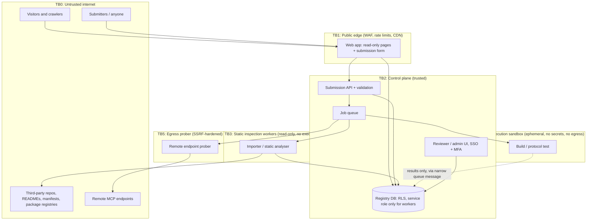

# Threat Model: Free MCP Registry

Scope: (a) the current application as audited, and (b) the target system that ingests thousands of third-party MCP server submissions and eventually verifies them. Companion documents: `security-audit.md` (findings), `target-architecture.md` (design that applies these mitigations).

## 1. Protected assets

| Asset | Why it matters |
|---|---|
| **Catalogue integrity** (what a listing says: repo URL, install command, endpoint, description) | Users copy install commands into their MCP clients and give the server access to files, shells, and accounts. A poisoned listing is a supply-chain attack on every user who trusts the registry. |
| **Registry trust/reputation** | Verification badges and "verified" states are the product; a false positive is worse than no badge. |
| **Submitter and maintainer identity** | Namespace ownership (who may speak for `github.com/owner/repo`); prevents impersonation and hijacking. |
| **Operator credentials and infrastructure** | DB service key, LLM key, GitHub token, deployment credentials, cloud account. |
| **Verification workers and their host network** | The only place third-party code may run; a breakout reaches everything else. |
| **Visitor privacy** | IPs and browsing of developers; analytics/ad scripts. |
| **Availability and cost budget** | LLM spend, GitHub API quota, database load, worker compute. |
| **Provenance data** | Original issue/PR text, authorship and timestamps; needed for attribution, disputes, removals. |

## 2. Trust boundaries (target system)

Rules: data crosses a boundary only through validated, size-limited, schema-checked messages; nothing in TB4 can reach TB2/DB directly; TB4/TB5 hold no long-lived secrets; TB3 never executes fetched content.

## 3. Threat actors

| Actor | Capability / motivation |
|---|---|
| **Opportunistic spammer / SEO operator** | Bulk-submits many near-identical entries to gain backlinks and AI-agent discovery (the upstream data shows single accounts filing hundreds of issues; see dataset analysis). |
| **Malicious MCP author** | Publishes a server whose install script, dependency tree, or tool descriptions steal credentials or manipulate the user's LLM. |
| **Impersonator / typosquatter** | Lists look-alike names/orgs (`@modelcontextprotocol/*`, lookalike GitHub owners) to ride on official trust. |
| **Competitor / griefer** | Submits false removal requests or edits to damage legitimate listings. |
| **Prompt-injection author** | Plants instructions in README/tool descriptions aimed at the registry's own LLM pipeline and at users' LLM clients. |
| **Compromised maintainer account** | A previously good project turns hostile after a takeover or a dependency compromise. |
| **External attacker against infrastructure** | Targets the app's known vulnerable dependencies, unauthenticated routes, or exposed keys. |
| **Curious insider / careless operator** | Runs imports with excessive credentials, or reviews a hostile repo on their own workstation. |

## 4. Attack scenarios and mitigations

Likelihood/impact are qualitative (H/M/L) and reflect the *current* application unless noted.

| # | Scenario | L / I | Current state | Mitigations (target) |
|---|---|---|---|---|
| T1 | **Anonymous overwrite/delete of listings** by calling `/api/submit-project` (confirmed against fixture) | H / H | Exploitable | No public write routes; authenticated submissions; RLS; append-only event log; reviewer approval for changes to install/endpoint fields |
| T2 | **Hijack a listing's install command or URL** to point at a malicious package (after T1, or by claiming someone else's repo) | M / **H** | Exploitable | Ownership proof: submitter must control the repository (GitHub OAuth, or a verification file in the repo / org membership); display "submitted by owner" vs "third party"; diff-based review of install-field changes |
| T3 | **Typosquat / impersonation** (e.g. package `@modelcontextprotocol/server-x` from a non-official owner; lookalike repo names) | M / H | Not detected | `official_scope_impersonation_possible` flag (implemented in importer); reserved-names list; edit-distance checks against popular servers; human review for flagged items |
| T4 | **Malicious install script or dependency** executed on a maintainer's or verifier's machine | M / H | Not applicable now | Static-only inspection by default; sandbox with no secrets/egress for dynamic tests; `--ignore-scripts`; never run imported code on the control plane or a laptop; hash-pinned dependencies |
| T5 | **Sandbox escape** from a build/protocol-test worker | L / H | N/A | microVM/gVisor, seccomp, non-root, read-only root, no Docker socket, separate account/VPC, kill-and-destroy per job, kernel/runtime patching cadence |
| T6 | **SSRF via submitted endpoint URL** (to cloud metadata `169.254.169.254`, internal services, localhost) | M / H | No probing exists today | Never fetch submitter URLs from the control plane; prober resolves DNS once, validates IP ranges, pins IP, blocks redirects, caps size/time, egress only through the prober (the importer already refuses restricted hosts and flags them) |
| T7 | **Prompt injection against the registry's LLM** (summaries/categories) leading to published phishing links or instructions | H / M | Exploitable (README → LLM → published) | No unreviewed LLM text on public pages; structured extraction with schema validation; strip/deny links in generated text; separate system and data channels; log and flag injection phrases |
| T8 | **Prompt injection against users' LLM clients via tool descriptions** that the registry displays or proxies | M / H | N/A today | Display tool metadata as inert quoted data, size-limited, no Markdown links; scanning for instruction-like text; warn users |
| T9 | **Cost/availability abuse** (unbounded LLM calls, bulk submissions, search scans) | H / M | Exploitable | Remove public LLM triggers; per-IP/per-account rate limits; queue concurrency caps; daily budgets and kill switch; cache search |
| T10 | **Spam flood**: one account files hundreds of entries; duplicates of the same repository under different names | H / M | Observed in upstream data | Per-account quotas; duplicate detection on canonical repo key at submission time (already designed); bulk-submitter flag; reputation tiers; auto-merge duplicates with provenance |
| T11 | **Takedown abuse / false removal request** | M / M | Manual | Removal requests are honoured *as suppression pending ownership check*; record requester identity; owner can always remove; non-owner requests go to review |
| T12 | **Verification false-positive** ("verified" shown for a server that merely builds or is reachable) | M / **H** (trust) | N/A | Distinct evidence levels never collapsed; each badge states what was actually tested and when; automatic expiry/re-verification; no single "verified" bit |
| T13 | **Compromised maintainer account / post-listing takeover** | L / H | Not monitored | Periodic re-inspection (repo transferred? archived? new owner? new install scripts?); change alerts; "last verified commit" pinning; user-visible diff since last review |
| T14 | **Exploitation of vulnerable framework** (`next@15.0.4` critical advisories) | M / H | Exploitable if deployed | Upgrade and pin; Dependabot/Renovate; `pnpm audit --prod` gate in CI |
| T15 | **Data exposure via database defaults** (anon key + no RLS) | M / H | Unknown, configuration not in repo | RLS on every table, deny-by-default, service key only in workers, periodic policy tests |
| T16 | **Leakage of operator secrets** via logs or third-party scripts | L / H | `console.log` of request data; third-party JS with full page privileges | Redacting logger; CSP; analytics with minimal scope; separate environments; secret scanning in CI |
| T17 | **Visitor tracking via attacker-chosen image URLs or inherited analytics IDs** | H / L | Exploitable | Image proxy/allow-list; remove inherited GA/AdSense; honest privacy policy |
| T18 | **Importer abuse**: hostile issue bodies exploiting the importer (ReDoS, huge inputs, terminal escape sequences in logs) | M / L | Partly mitigated | Importer is text-only (never evaluates or fetches body content), output is JSON-encoded, tokens are redacted from logs. Observed maxima: issue body 15,460 chars, #1 comment 54,756 chars. `normalize.mjs` caps pattern-matching input at 100,000 characters (raw data keeps the full text). **Not done:** regex fuzzing / ReDoS testing; recommended before processing live data continuously |
| T19 | **Provenance loss or alteration** (disputes over who submitted what) | L / M | N/A | Raw records are stored unmodified and separately from normalised data; collection timestamp, source URL and author recorded; hash of raw record in manifest |
| T20 | **Licensing / legal exposure** (republishing descriptions, READMEs, avatars) | M / M | Not addressed | Store facts and short excerpts with attribution; link rather than copy; respect licenses (SPDX recorded); takedown process; Terms of Service reflecting actual operation |

## 5. Residual risks to accept explicitly

* A server can pass every automated check and still be harmful (static analysis and a protocol handshake cannot prove benign behaviour). The product must say so in plain language and offer user-side controls (permissions, sandboxing guidance).
* Hosted/remote servers can change behaviour after verification; verification statements must carry timestamps and expire.
* Sandbox technology has vulnerabilities; defence in depth (no secrets, no egress, separate account) limits the blast radius but does not eliminate the risk. Dynamic execution therefore stays opt-in and off by default for unreviewed submissions.

## 6. Security requirements derived from this model (for `product-requirements.md` and the roadmap)

1. No public write path without authentication and ownership proof.
2. Raw submission data is immutable; normalised/curated data is derived and versioned.
3. Any text originating from a submitter is untrusted at every sink (HTML, Markdown, logs, prompts, CSV).
4. Verification evidence levels are separate, timestamped, and expire.
5. No third-party code runs outside TB4; TB4 has no secrets and no ambient network.
6. Every outbound request on behalf of a submission goes through an SSRF-hardened prober; the control plane never fetches submitter-supplied URLs.
7. All privileged actions (publish, unpublish, override a flag) are attributable and logged.
